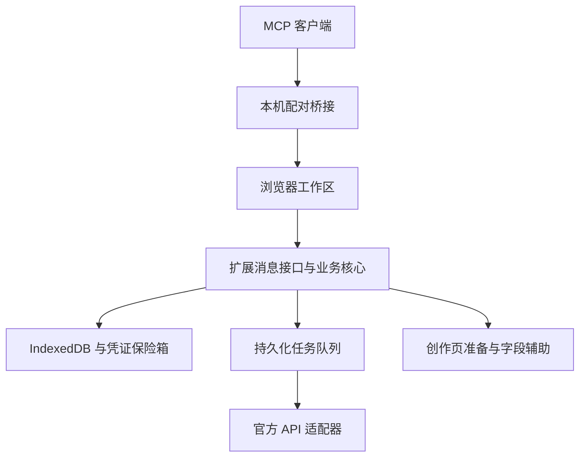

# MatriXpost 0.5 架构

## 数据流

扩展工作区与 MCP 客户端共用同一组草稿、账号和任务对象。每次发布固定一个内容修订和一个账号；批量发布拆成独立任务，因此一个平台失败不会把其他平台的成功状态抹掉。

核心使用原生 ES modules、IndexedDB 和 Web Crypto。UI 为原生 HTML/CSS/JavaScript，MCP 桥接使用 Node 内置模块。没有编译框架、远程脚本、运行时 npm 包或内置模型调用。

## 模块

| 路径 | 职责 |
| --- | --- |
| `extension/app.*` | 创作、草稿、队列、账号、平台、AI 六个视图 |
| `extension/background.js` | 可信来源校验、消息路由、恢复与定时唤醒 |
| `extension/core/engine.js` | 输入校验、并发写入序列化、任务状态与授权范围 |
| `extension/core/store.js` | IndexedDB 事务与测试用内存存储 |
| `extension/core/vault.js` | PBKDF2 派生密钥、AES-GCM 凭证加密、会话解锁 |
| `extension/core/model.js` | 草稿修订、公开投影、金额与 ID 验证 |
| `extension/core/assisted.js` | 对用户选定的发布页做保守字段填充 |
| `extension/adapters/` | 平台字段校验、权限范围、分阶段执行和结果核对 |
| `bridge/` | MCP stdio、回环 HTTP 队列、配对和方法白名单 |
| `tests/` | 核心、平台协议与桥接验证 |
| `scripts/browser-test.mjs` | 真实 Chromium 扩展验收与截图自检 |

## 任务状态

| 状态 | 含义 | 后续动作 |
| --- | --- | --- |
| `prepared` | 辅助模式内容已准备 | 在官方后台上传素材并完成提交 |
| `awaiting_approval` | AI 请求公开发布，固定快照待核对 | 用户在工作区核对并批准 |
| `queued` | 等待计划时间或下一个执行步骤 | 浏览器运行时自动处理 |
| `running` | 当前平台请求正在发送 | 等待远端结果，禁止取消已发出的请求 |
| `blocked` | 本地凭证、权限或素材阻止执行 | 修复条件后重试 |
| `failed` | 平台明确拒绝或可报告的失败 | 根据错误修复或重试 |
| `uncertain` | 请求已发出，结果需要远端核对 | 核对已有对象，避免盲目重复创建 |
| `succeeded` | 适配器已收到可核实结果 | 阅读 `result.status`、远端 ID 和链接 |
| `cancelled` | 待执行任务已取消 | 不继续发送 |

`succeeded` 表示指定 API 流程取得结果。YouTube 可能返回 `processing`，商品可返回 `draft`；界面保留平台状态，公开发布需要对应平台实际确认。接口不会用单个 HTTP 200 代替平台结果校验。

## 一致性与恢复

草稿更新使用修订号比较，防止两个窗口覆盖。没有内容变化的保存保留修订号；入队时再次校验预览修订。任务键由草稿 ID、内容修订、账号 ID 和动作组成，重复点击返回已有任务。

每个适配器步骤之前，核心先持久化正在执行的状态；步骤结束后保存检查点。YouTube 通过已有上传会话查询服务器偏移，原位发布通过已有对象 ID 更新。对非幂等创建请求，未知结果不会自动重发。已经保存到远端的草稿正式发布时，核心把原检查点交给原位发布流程，历史记录仍保留其原状态。

Chrome 会停止空闲 service worker，因此长期状态存入 IndexedDB。30 秒队列闹钟和工作区活动负责唤醒执行；关闭浏览器不会让定时任务在后台继续运行。参考 [Chrome 生命周期文档](https://developer.chrome.com/docs/extensions/develop/concepts/service-workers/lifecycle)。

## 凭证和访问边界

每个账号的凭证密文绑定账号 ID。PBKDF2-SHA256 使用随机盐和 600,000 次迭代，生成 AES-256-GCM 密钥；每次加密产生独立 96 位 IV。解锁密钥仅存入 `chrome.storage.session` 的可信扩展上下文。浏览器重启后会话密钥消失，持久化数据保留密文。

后台消息仅接受自身 `app.html` 来源。扩展没有外部消息入口、默认网站访问权限或 Cookie 权限。API 适配器固定方法和请求路径，检查目标域名并禁止带密码地址与重定向；自建 WooCommerce 店铺需要显式授予精确 HTTPS origin。

AI 桥接绑定 `127.0.0.1`，同时校验 Host、配对码和精确扩展 Origin。请求只投递一次，过期未投递请求会移除，已经投递但回执丢失会返回结果未知。MCP 方法白名单不开放保险箱与凭证管理；返回值排除凭证和上传会话能力地址。

本地草稿、商品描述和素材本身未做内容加密；它们受浏览器配置和操作系统权限保护。元数据导出也包含用户选择保存的内容。这里的保险箱专门保护账号凭证。

## 添加平台

在 `core/catalog.js` 登记真实接入方式，在 `adapters/` 实现字段验证、精确权限和 `executeStep`。每一步需要明确哪些副作用已经发生、如何保存远端 ID、可否安全恢复、最终状态如何核对。仅有后台链接的平台保留辅助模式。

新增适配器先用平台协议 fixture 验证请求和错误语义，再使用获准应用与真实测试账号验证。记录具体测试条件与远端结果后，才能把能力矩阵中的真实账号状态更新为已验证。
